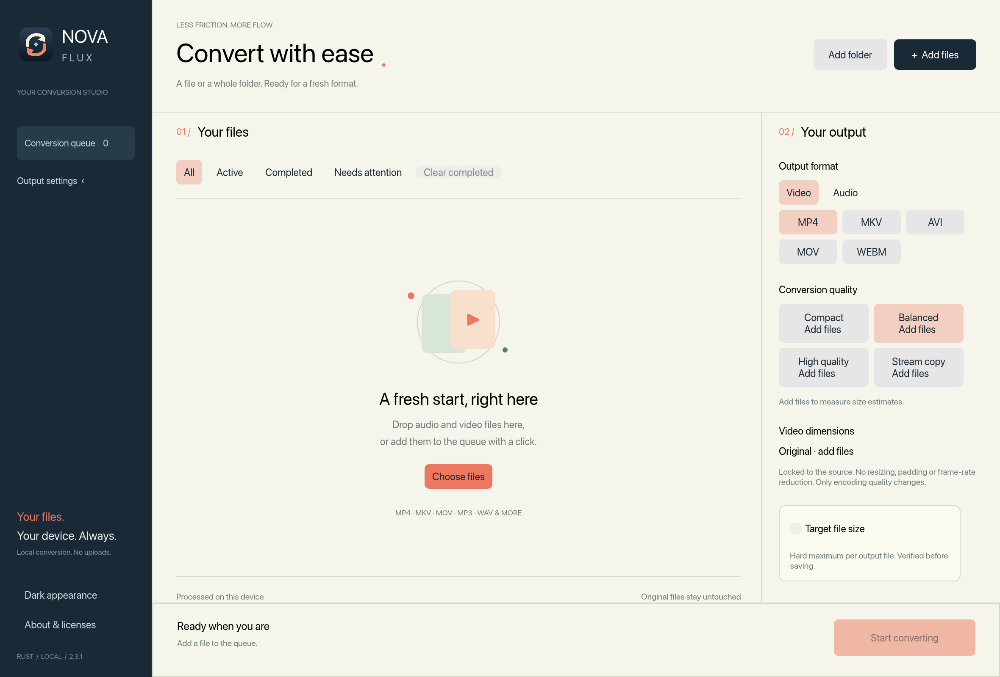
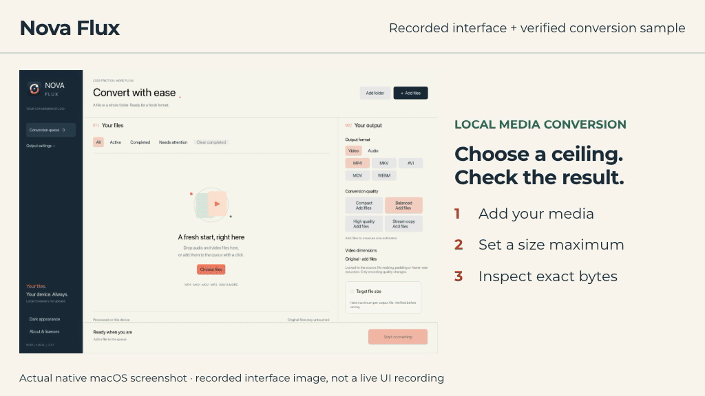
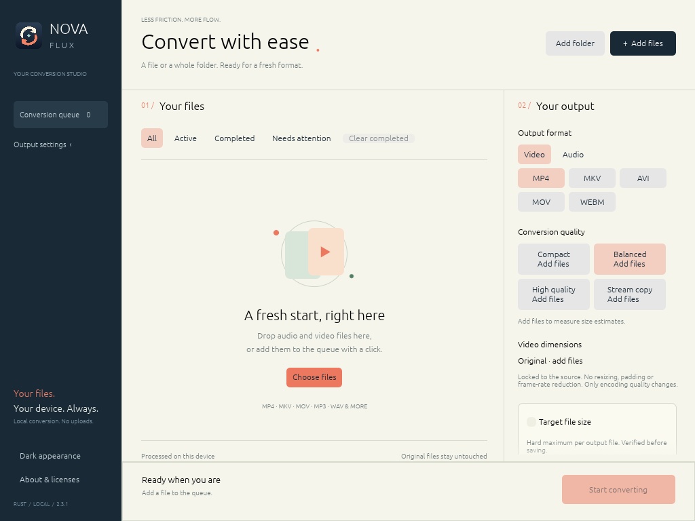
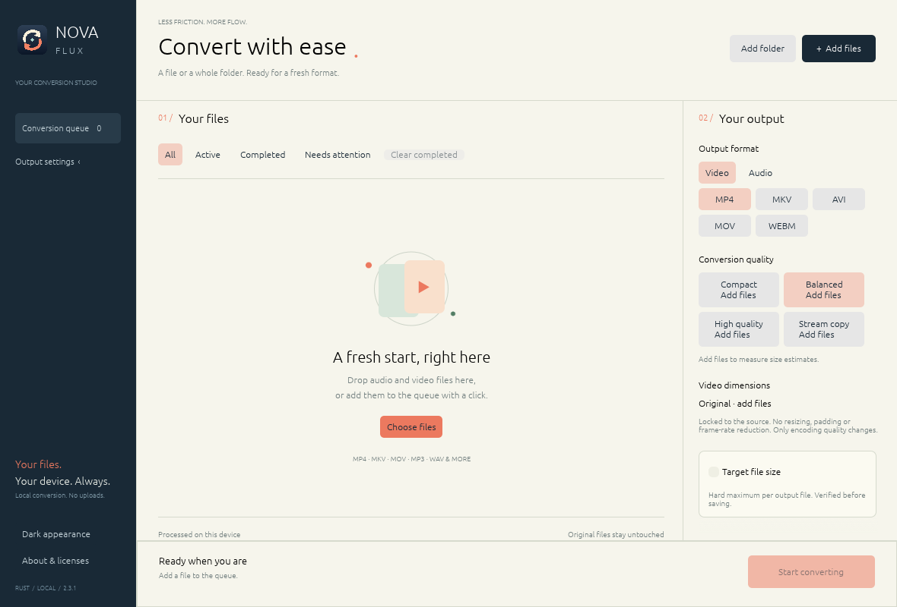

<h1 align="center">Nova Flux</h1>

Local media conversion. Built in Rust.

Convert audio and video, set a verified file-size maximum, and keep original video dimensions.

## Download

**Public prerelease 2.3.1.** Download the application archive for your operating system and processor:

| System | Application download | Tested baseline |
| --- | --- | --- |
| macOS · Apple Silicon (M1 or newer) | [Download macOS ZIP](https://github.com/mohamadrezamakanani-dotcom/nova-flux/releases/download/v2.3.1/Nova-Flux-2.3.1-macos-arm64.zip) | Apple M4, macOS 27.0.1 |
| Windows · x64 | [Download Windows ZIP](https://github.com/mohamadrezamakanani-dotcom/nova-flux/releases/download/v2.3.1/Nova-Flux-2.3.1-windows-x86_64.zip) | Windows Server 2022 native CI |
| Linux · x64 | [Download Linux tar.gz](https://github.com/mohamadrezamakanani-dotcom/nova-flux/releases/download/v2.3.1/Nova-Flux-2.3.1-linux-x86_64.tar.gz) | Ubuntu 22.04, X11/Vulkan |

[All release files and SHA-256 checksums](https://github.com/mohamadrezamakanani-dotcom/nova-flux/releases/tag/v2.3.1) · [Codec source ZIP](https://github.com/mohamadrezamakanani-dotcom/nova-flux/releases/download/v2.3.1/Nova-Flux-2.3.1-FFmpeg-sources.zip) · [Validation record](VALIDATION.md)

### Start in three steps

1. Extract the **whole archive**. Keep its runtime and license folders together. Source ZIPs are for developers, not installers.
2. Open **Nova Flux.app** on macOS, **nova-flux.exe** on Windows, or **nova-flux** on Linux. No Rust, FFmpeg installation, account or codec download is required by the packaged app.
3. Add files, choose a format and output folder, then select **Start converting**. Enable **Target file size** to set a maximum in decimal MB.

macOS is ad-hoc signed and **not Apple-notarized**; Windows executables are **unsigned**, so OS warnings may appear. Linux needs compatible desktop libraries, graphics drivers and an XDG portal for dialogs. The Linux codec baseline is Ubuntu 22.04 glibc. Intel Macs and Windows/Linux ARM packages are not provided. See [platform scope](docs/CROSS_PLATFORM.md) and [troubleshooting](SUPPORT.md).

## What it does

- **Local processing:** no uploads, cloud account, telemetry or runtime downloads.
- **Video:** MP4, MKV, AVI, MOV and WebM. **Audio:** MP3, WAV, AAC, OGG, M4A and FLAC.
- **Verified compression:** Compact, Balanced and High quality set maximums of **40%, 65% and 85% of source bytes**. Explicit size targets override these presets. Actual bytes are verified before saving.
- **Original geometry:** no resizing, padding, frame-rate reduction or shortening of the selected streams. Impossible limits fail clearly without saving an oversized output.
- **Batch workflow:** add files/folders, drag and drop, cancel, retry and reveal outputs. Original files and existing outputs are not overwritten.
- **Adaptive work:** CPU/RAM-aware scheduling; compatible Apple hardware is measured against CPU encoding. Windows/Linux currently use CPU codecs.

The UI is native English Rust with egui/eframe/wgpu. FFmpeg/ffprobe are separate native media tools. There is no WebView or JavaScript UI. Selected streams are the first non-artwork video and first audio; alternate audio/subtitles are outside the current contract. Lossy compression can reduce visible and audio quality; retaining dimensions does not retain original quality.

[Full user guide](docs/USER_GUIDE.md) · [Build from source](docs/BUILDING.md)

## Watch a verified conversion sample

This 12-second silent demonstration combines the actual native interface image
with playback of a generated original and its real app-produced output. It is
not a live UI recording or an encoding-speed benchmark. The sample retained
1920×1080 and all 90 frames while fitting a 500,000-byte maximum.
[Demo source and verification](docs/DEMO_PROVENANCE.md).

## See it on each platform

Windows and Linux native screenshots

**Windows — DX12/WARP native CI capture**

**Linux — X11/Vulkan native CI capture**

## What has been verified

| Published package | Native Rust tests | Final extracted package |
| --- | --- | --- |
| macOS arm64 | 100 passed | Bundled diagnosis and actual Metal rendering passed |
| Windows x64 | 78 passed | Bundled diagnosis and actual DX12/WARP rendering passed |
| Linux x64 | 100 passed | Bundled diagnosis and actual X11/Vulkan rendering passed |

Each runtime also passed 12 actual encode/probe/decode checks. The installed Mac app was used for a real 500,000-byte target conversion: **486,199 output bytes**, retaining **1920×1080, 30 fps and all 90 frames**. These results apply to the recorded hosts/revisions; manual physical Windows/Linux desktop acceptance remains unverified.

The **Source validation** badge refers to the public source/media/UI workflow. It is separate from the [matched-runtime package evidence](docs/evidence/matched-2.3.1.json). [Validation details](VALIDATION.md) · [Manual acceptance matrix](docs/MANUAL_ACCEPTANCE.md) · [Public package-build workflow](docs/PUBLIC_RELEASE_BUILD.md)

## Help and contribute

[Get help](SUPPORT.md) · [Report a bug](https://github.com/mohamadrezamakanani-dotcom/nova-flux/issues/new?template=bug_report.yml) · [Suggest a feature](https://github.com/mohamadrezamakanani-dotcom/nova-flux/issues/new?template=feature_request.yml) · [Contribute](CONTRIBUTING.md) · [Security reports](SECURITY.md)

[Changes](CHANGELOG.md) · [Roadmap](docs/ROADMAP.md) · [Community guidelines](CODE_OF_CONDUCT.md)

## Licenses and source

Nova Flux application code is [MIT licensed](LICENSE). FFmpeg and codec dependencies retain their own terms; this runtime is GPL-3.0-or-later, without nonfree components. All nine exact original codec source archives, build instructions and component notices are inside every application package. Matching codec sources are also a separate release download. Target-selected Rust, embedded-font and Rust standard-library notices are included. **About & licenses** opens the bundled notices.

[Third-party notices](THIRD_PARTY.md) · [Rust/font notice collection](docs/RUST_NOTICES.md) · [Verified packaging](docs/VERIFIED_PACKAGING.md)
